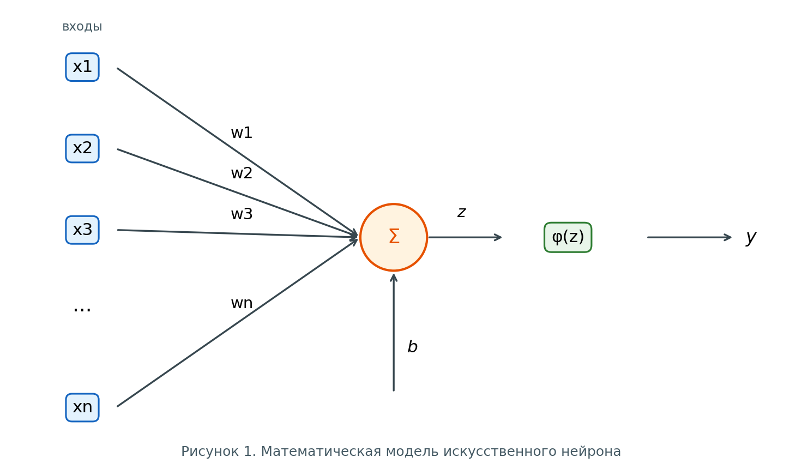
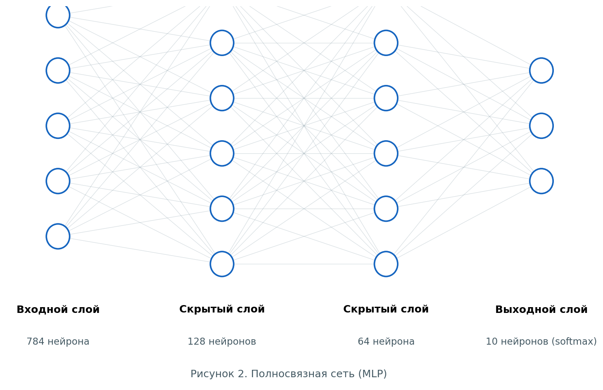
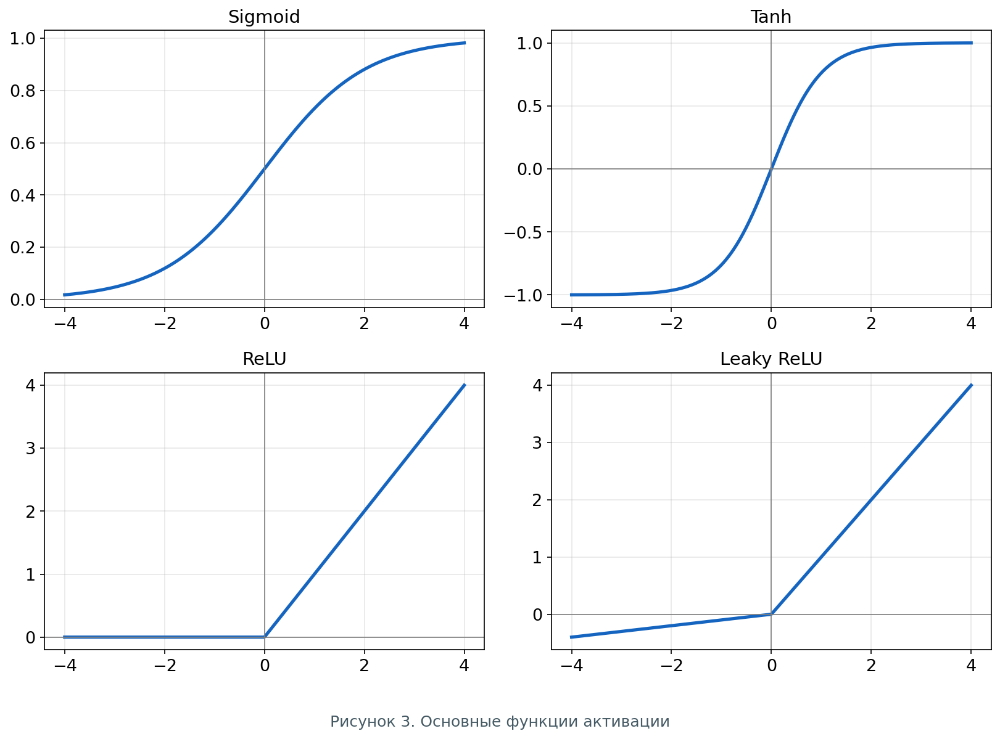
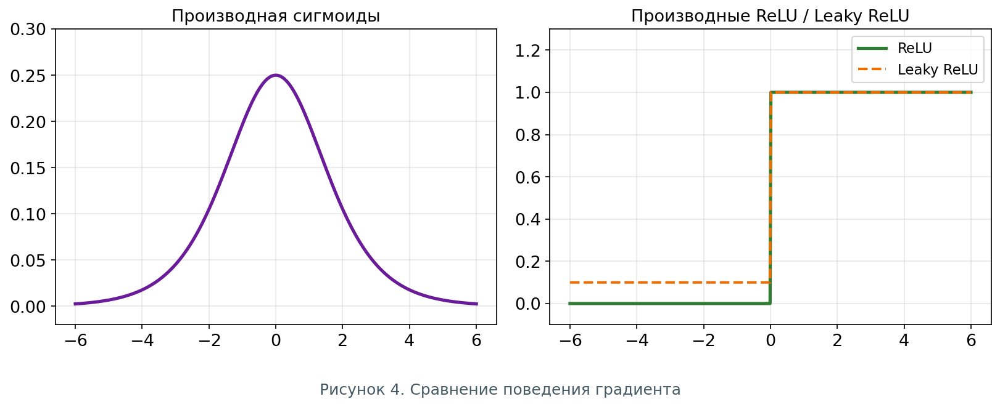
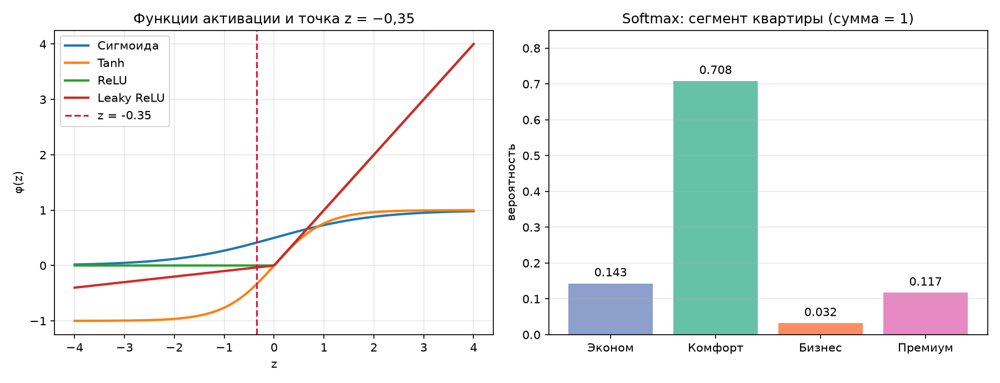

# Лекция 1.1. Основные понятия: нейроны, слои, функции активации

**АНО ВО «Университет «Технополис»** · Дисциплина «Нейронные сети в машинном обучении» (6 семестр, 09.03.03 Прикладная информатика)

Объём: 1 акад. час лекция + 3 акад. часа лабораторная работа. 

## 1. План лекции

| № | Блок | О чём |
|---|------|-------|
| 1 | Мотивация: где работают нейросети и почему это работает | Знакомые примеры — распознавание лиц, ChatGPT, кредитный скоринг — как частные случаи одной технологии: функции, обучаемой на данных |
| 2 | Историческая справка: от модели нейрона до глубокого обучения | Путь от модели нейрона Маккаллока и Питтса до трансформеров: почему идея ждала 70 лет и что расшевелило её в 2012-м |
| 3 | Искусственный нейрон: математическая модель | Что нейрон делает математически: взвешенная сумма, смещение, функция активации; как выглядит в векторной записи и на числах |
| 4 | Слои и типовые архитектуры | Как нейроны собираются в слои и сети: вход, скрытые слои, выход; зачем нужны сверточные и рекуррентные слои; как считать параметры |
| 5 | Функции активации: зачем нелинейность | Почему без нелинейности многослойная сеть вырождается в одну линейную; разбор sigmoid, tanh, ReLU и их градиентов |
| 6 | Практика прямого прохода + итоги | Считаем нейрон вручную на конкретных числах, сверяем с таблицей активаций и фиксируем выводы по лекции |

## 2. Мотивация

Как Facebook находит вас на фото? Как ChatGPT дописывает предложение? Как ипотечный скоринг решает, одобрить ли кредит? Общий знаменатель всех этих систем — **нейронная сеть**: функция, которая обучается на примерах, а не программируется вручную.

Ключевая мысль: нейронная сеть — это **композиция простых вычислений** (взвешенная сумма + нелинейность), организованных слоями. Вся система глубокого обучения сводится к тому, что из миллионов таких простых операций возникает сложное поведение.

## 3. Историческая справка: от нейрона до трансформеров

Идея нейронной сети старше компьютера, на котором вы это читаете, почти на два десятилетия. Но путь от первой математической модели нейрона до современных языковых моделей занял более 80 лет — и не был прямым: были взлёты, долгие периоды застоя («зимы ИИ») и два прорыва. Полезно видеть эту траекторию: она объясняет, почему в курсе мы учим именно то, что учим.

### 1943 — модель Маккаллока и Питтса

Нейрофизиолог Уоррен Маккаллок и логик Уолтер Питтс показали: нейрон можно описать как простое логическое устройство, которое суммирует входные сигналы и срабатывает, если сумма превышает порог. Из таких элементов, как они доказали, можно собрать любую логическую функцию. Это первое математическое описание нейрона — и вся современная глубина обучения выросла из этой идеи.

### 1958 — перцептрон Розенблатта

Фрэнк Розенблатт построил первую *обучаемую* машину: перцептрон сам подбирал веса по примерам, а не настраивался вручную. Появилось и железо — Mark I, и громкие обещания: пресса писала о машинах, которые «скоро будут ходить, говорить и осознавать себя». Появился и алгоритм обучения, который мы реализуем позже в упрощённом виде.

### 1969 — «зима ИИ»

Марвин Минский и Сеймур Пейперт в книге «Perceptrons» строго показали ограничения однослойного перцептрона: он не способен выучить даже функцию XOR — исключающее «или». Замечание было справедливым, но читалось как приговор всей области: финансирование и публикации резко сократились. Мораль для нас двоякая: однослойная сеть действительно ограничена, но многослойная — нет; проблема была в отсутствии метода обучения таких сетей, а не в самой идее.

### 1986 — backpropagation

Румельхарт, Хинтон и Уильямс популяризировали алгоритм обратного распространения ошибки: градиент функции потерь считается от выхода к входу, и многослойные сети наконец можно обучать эффективно. 

### 1997 — LSTM

Зайдхубер и Хохрайтер предложили LSTM — рекуррентную сеть с «ячейкой памяти», решающую проблему затухающих градиентов на длинных последовательностях. Долгие годы LSTM оставалась рабочей лошадкой обработки текста и временных рядов.

### 2012 — AlexNet и эра глубокого обучения

Сверточная сеть AlexNet выиграла соревнование ImageNet с отрывом, который никто не ожидал: ошибка классификации упала почти вдвое по сравнению с классическими методами. Секрет оказался прозаичен: GPU, большие данные и ReLU — та самая функция активации. После 2012 года «глубокое обучение» перестало быть нишевым термином.

### 2017 — «Attention is All You Need»

Восемь инженеров Google предложили трансформер: архитектуру, целиком построенную на механизме внимания, без рекуррентности. На ней выросли BERT, GPT и всё современное поколение языковых моделей — включая ChatGPT.

### Сводная таблица

| Год | Событие | Значение |
|-----|---------|----------|
| 1943 | Модель нейрона Маккаллока и Питтса | Первое математическое описание нейрона как логического устройства |
| 1958 | Перцептрон Розенблатта | Первый обучаемый алгоритм; катализатор интереса к теме |
| 1969 | Книга Минского и Пайперта | Неспособность однослойного перцептрона к XOR — «зима ИИ» |
| 1986 | Backpropagation (Румельхарт, Хинтон, Уильямс) | Практическое обучение многослойных сетей |
| 1997 | LSTM (Хохрайтер, Шмидхубер) | Память в рекуррентных сетях; стандарт обработки последовательностей на два десятилетия |
| 2012 | AlexNet выигрывает ImageNet | Начало эры глубокого обучения: GPU + большие данные + ReLU |
| 2017 | «Attention is All You Need» | Трансформеры — основа современных LLM (GPT, BERT) |

**Что запомнить из истории:** три сдвига сделали нейросети тем, что они есть, — метод обучения многослойных сетей (1986), масштаб вычислений (2012) и новая архитектура взамен рекуррентности (2017). Всё остальное — эволюция внутри этих рамок.

## 4. Искусственный нейрон: математическая модель

### 4.1. Биологическая аналогия

Реальный нейрон — клетка мозга — устроен по простой схеме: получает сигналы от других нейронов через ветвящиеся отростки-дендриты, суммирует всё пришедшее в теле клетки и, если суммарный сигнал превышает порог возбуждения, передаёт импульс дальше по длинному отростку — аксону. Сильные входные связи вносят больший вклад в сумму, слабые — меньший; некоторые связи вообще тормозящие, они работают «против» возбуждения.

Схема простая: приём сигналов → суммирование с учётом силы связей → сравнение с порогом → передача.

Искусственный нейрон — упрощённая математическая модель этого процесса. Мы не пытаемся воспроизвести биохимию: связи заменяем числами (весами), суммирование — обычной арифметикой, порог — обучаемым параметром (смещением). В итоге получаем устройство, которое можно посчитать на бумаге за минуту и запрограммировать в пять строк Python.



### Что видно на схеме

Разберём рисунок 1 по частям — каждый элемент схемы имеет точный математический смысл:

- **Входы x₁, x₂, x₃, …, xₙ** (слева, синие блоки) — то, что нейрон получает извне: значения признаков объекта. Например, для задачи предсказания цены квартиры это могут быть площадь, этаж и расстояние до метро.
- **Стрелки с весами w₁, w₂, w₃, …, wₙ** — связи между входами и нейроном. Каждая стрелка «пропускает» сигнал через свой множитель: сигнал умножается на вес до того, как попадёт в сумму. Толщина и знак веса на схеме не показаны, но именно они определяют, насколько сильно вход влияет на результат.
- **Круг с буквой Σ** — сумматор, «тело» нейрона. Он складывает все взвешенные сигналы, пришедшие по стрелкам. Всё, что происходит внутри круга, — это одна операция сложения.
- **Стрелка снизу с меткой b** — смещение (bias). Оно прибавляется к сумме отдельно, без своего входа: это постоянная добавка, которую нейрон прибавляет всегда, независимо от значений x.
- **Блок φ(z)** (справа, зелёный) — функция активации. На вход блока идёт промежуточная величина z — сумма взвешенных сигналов плюс смещение; на выходе — итоговый ответ нейрона после нелинейного преобразования. Какие бывают функции активации — отдельный вопрос, вернёмся к нему позже.
- **Выход y** (справа) — результат работы нейрона, единственное число. Именно оно уходит на входы нейронов следующего слоя — или является финальным ответом сети, если нейрон последний.

Прочитав схему слева направо, получаем «конвейер» нейрона: входы → умножение на веса → суммирование (+ b) → активация → выход. 

### 4.2. Две операции нейрона

Нейрон выполняет ровно две операции, одну за другой:

- **Шаг 1.** взвешенное суммирование входов со сдвигом (смещением);
- **Шаг 2.** применение функции активации к результату.

**Шаг 1.** Каждый вход умножается на свой вес, все произведения складываются, к сумме прибавляется смещение. Получается величина z — «внутреннее состояние» нейрона:

$$
z = w_1 x_1 + w_2 x_2 + \ldots + w_n x_n + b = \sum_{i=1}^{n} w_i x_i + b
$$

**Шаг 2.** Сумма z пропускается через функцию активации φ — получается выход нейрона y:

$$
y = \varphi(z)
$$

Результат y уходит на входы нейронов следующего слоя — или является итоговым ответом сети, если нейрон последний.

Разделение на два шага не случайно. Шаг 1 — линейная операция: она может лишь усиливать, ослаблять и складывать сигналы, но не может «переключать» поведение. Шаг 2 — нелинейная: именно она решает, «сработал» нейрон или промолчал, и делает всю сеть способной к сложным зависимостям.

### 4.3. Интуиция компонентов

- **Входы x** — числовые признаки объекта: пиксели изображения, слова текста, столбцы таблицы. Нейросеть не «смотрит на фото» — она получает вектор чисел, и всё остальное вычисление происходит уже с числами.
- **Веса w** — обучаемые параметры, «сила связи». Большой положительный вес усиливает вклад признака, отрицательный — подавляет. Обратите внимание: веса — это и есть «знания» сети. Когда говорят «модель обучилась», имеют в виду, что нашлись удачные веса.
- **Смещение b** (bias) — порог: регулирует, при каком суммарном сигнале нейрон «активируется». Не привязан к входам — это свободный параметр, который тоже обучается. 
- **φ — функция активации** — нелинейное преобразование. Без неё нейрон — просто линейная регрессия, а многослойная сеть вырождается в один слой. 

Заметьте важное разделение: x — то, что приходит извне, а w и b — то, что сеть *подбирает сама* в процессе обучения. Данные заданы, параметры — нет. Именно поиском весов и смещений занимается алгоритм обучения, о котором пойдёт речь дальше.

### 4.4. Векторная запись

Ту же формулу удобно записать коротко, в векторном виде:

$$
z = \mathbf{w}^\top \mathbf{x} + b, \quad \text{где } \mathbf{w} = (w_1, \ldots, w_n), \ \mathbf{x} = (x_1, \ldots, x_n)
$$

Здесь $$ \mathbf{w}^\top \mathbf{x} $$ — скалярное произведение векторов: попарные произведения и сумма, то есть ровно та же формула шага 1, только компактно.

Привыкать к векторной записи важно сразу: в фреймворках (PyTorch, Keras) нейрон — это одна операция matmul + add, а для целого слоя умножают сразу матрицу на вектор, без циклов по нейронам. Это ещё и причина, почему обучение сетей так хорошо ложится на GPU: умножение матриц — массовая операция, которую GPU выполняет тысячами параллельных потоков.

### 4.5. Пример с числами — полный разбор

Возьмём нейрон с тремя входами. Даны:

$$
\mathbf{x} = (1{,}0;\ 0{,}5;\ 2{,}0), \quad \mathbf{w} = (0{,}4;\ -0{,}6;\ 0{,}2), \quad b = 0{,}1
$$

**Шаг 1. Считаем z — по одному слагаемому:**

- первое:$$ 0{,}4 \cdot 1{,}0 = 0{,}4 $$ — сильная положительная связь;
- второе: $$ -0{,}6 \cdot 0{,}5 = -0{,}3 $$ — тормозящая связь: понижает сумму;
- третье: $$ 0{,}2 \cdot 2{,}0 = 0{,}4 $$ — слабая связь, но большой вход;
- плюс смещение: $$ +0{,}1 .$$

Складываем:

$$
z = 0{,}4 - 0{,}3 + 0{,}4 + 0{,}1 = 0{,}6
$$

Что здесь важно увидеть:

- вклад признака определяется *произведением* w·x, а не весом самим по себе: у третьего входа вес маленький (0,2), но вход большой (2,0) — и вклад получился таким же, как у первого;
- второе слагаемое отрицательное — тормозящая связь реально «вычитается» из суммы;
- если бы смещения не было, z был бы 0,5 — меньше; смещение сдвинуло нейрон ближе к срабатыванию.

**Шаг 2. Пропускаем z = 0,6 через функцию активации φ.** Какая именно функция стоит в блоке φ — пока не важно. Суть в том, что активация превращает «сырую» сумму z в ответ нейрона: где-то усиливает, где-то обнуляет, где-то сжимает в заданный диапазон.

**Вывод:** один и тот же нейрон даёт разный ответ в зависимости от выбранной активации — значит, выбор активации — это **архитектурное решение**.

## 5. Слои и архитектуры

Нейроны объединяются в слои: все нейроны слоя получают одни и те же входы и работают параллельно. Слои соединяются последовательно: выход предыдущего — вход следующего.



Три «этажа» любой сети:

- **Входной слой** — принимает сырые данные. Число нейронов = размерность признаков (28×28 пикселей → 784 нейрона).
- **Скрытые слои** — промежуточные преобразования. Именно здесь сеть «изобретает» признаки: первые слои выделяют простые фрагменты, глубокие — сложные комбинации. Глубина (число скрытых слоёв) — то, что отличает «глубокое» обучение.
- **Выходной слой** — выдаёт результат. Размер зависит от задачи: 1 нейрон + sigmoid — бинарная классификация; 10 нейронов + softmax — классификация на 10 классов; 1 нейрон без активации (линейный) — регрессия.

**Типы слоёв, которые изучим в этом курсе:**

| Тип слоя | Что делает | Применение |
|----------|-----------|------------|
| Полносвязный (Dense) | Каждый нейрон связан со всеми нейронами предыдущего слоя | Табличные данные, финальная классификация; «скелет» MLP |
| Сверточный (Conv2D) | Скользящий фильтр выделяет локальные паттерны (края, текстуры) | Изображения, видео (CNN) |
| Рекуррентный (RNN/LSTM) | Обрабатывает последовательность шаг за шагом с «памятью» | Тексты, временные ряды |

Отдельно существуют **служебные слои** — Dropout и BatchNorm: они не выполняют вычислений над данными, а помогают обучению (защита от переобучения и нормализация активаций).

**Число параметров полносвязного слоя** — считаем так: каждый выходной нейрон имеет по одному весу на каждый вход, плюс одно смещение на нейрон. Поэтому:

$$
P = n_{\text{вх}} \cdot n_{\text{вых}} + n_{\text{вых}}
$$

Пример: слой 784 → 128 даёт 784 · 128 + 128 = 100 480 параметров. Отсюда видно, почему сети «тяжёлые» и почему нужны GPU.

## 6. Функции активации

**Зачем вообще нелинейность** — главный вопрос лекции. Начнём с простого эксперимента в уме: если между слоями нет активации, композиция линейных операций остаётся линейной. Раскроем скобки в выражении $$ W_2(W_1 x + b_1) + b_2 $$ — получим $$ (W_2 W_1) x + (W_2 b_1 + b_2) :$$ произведение двух матриц, свёрнутое в одну. Десять слоёв, сто слоёв — результат один и тот же: без активации вся сеть математически эквивалентна **одному линейному слою**. Она не сможет выучить даже XOR — задачу, где «загорается ровно один из двух входов», не решается никакой прямой линией.

Активация вносит нелинейность на каждом слое — и это позволяет аппроксимировать сколь угодно сложные зависимости (это гарантирует теорема об универсальной аппроксимации; строгую формулировку найдёте в доплитературе). Функция активации — «дозатор» между слоями: она решает, сколько сигнала пропустить дальше и в каком виде.



Дальше разберём пять функций по одной схеме: что это за функция на интуитивном уровне, зачем она нужна и где применяется, и только затем — формула.

### 6.1. Sigmoid — «сглаженный переключатель»

**Что это.** Функция, которая сжимает любое число — хоть −1000, хоть +1000 — в узкий диапазон от 0 до 1. Большие положительные входы превращаются в числа, близкие к 1; большие отрицательные — близкие к 0; ноль даёт ровно 0,5. График — плавная S-образная кривая, за что функция и получила своё имя (sigma — латинская S).

**Зачем.** Диапазон (0; 1) идеально совпадает с понятием **вероятности**: если выход сети — это «с вероятностью 0,85 это спам», то получить такое число удобнее всего сигмоидой. Поэтому сигмоида живёт в выходном слое бинарных классификаторов: спам/не спам, больной/здоровый, одобрен/отклонён. Исторически это первая функция активации нейронов — ей обучались и перцептронные модели 60-х.

**Как её использовать нельзя.** Сигмоида — плохая активация для скрытых слоёв, и вот почему. Края кривой почти плоские: в диапазоне |z| > 6 выход уже почти не меняется. Если нейрон попал в этот «пологий» участок, малейшее изменение весов почти не меняет выход — а значит, при обучении (мы будем двигать веса пропорционально тому, как меняется выход) сигнал ошибки затухает до нуля. Это явление называется **насыщением**, и в глубоких сетях с сигмоидами в скрытых слоях оно убивает обучение. Плюс выход всегда положительный и экспонента дорога в вычислениях.

**Формула:**

$$
\sigma(z) = \frac{1}{1 + e^{-z}}
$$

Проверьте интуицию на числах: $$ \sigma(0) = 0{,}5 ;$$ $$ \sigma(10) \approx 0{,}99995 ;$$ $$ \sigma(-10) \approx 0{,}00005 .$$ Всё сходится: большие по модулю входы «прилипают» к краям диапазона — это и есть насыщение.

### 6.2. Tanh — «сигмоида, отцентрованная на ноль»

**Что это.** Гиперболический тангенс — по форме та же S-образная кривая, но диапазон другой: от −1 до 1. Ноль входа даёт ноль выхода, положительные входы — положительные выходы, отрицательные — отрицательные. Знак входа сохраняется.

**Зачем.** Ноль в центре диапазона — не косметика, а ускорение обучения. Если активации слоя всегда положительные (как у сигмоиды), то и градиенты следующего слоя по всем весам получаются одного знака — их обновления идут «зигзагом», и сходимость замедляется. Центрированные вокруг нуля значения танхенса ослабляют этот эффект. Знакосохранение полезно и семантически: выход −0,8 читается как «сильное противодействие», +0,8 — как «сильная поддержка».

**Как её использовать нельзя.** Насыщение на краях никуда не делось — оно то же, что у сигмоиды, просто симметричное. Поэтому в глубоких полносвязных сетях танхенс тоже не используют.

**Где живёт сегодня.** Внутри рекуррентных сетей (LSTM) и в старых классических архитектурах. Это типичное место применения: там сети неглубокие, а центрирование важно.

**Формула:**

$$
\tanh(z) = \frac{e^z - e^{-z}}{e^z + e^{-z}}
$$

Любопытный факт: танхенс — это просто масштабированная сигмоида: $$ \tanh(z) = 2\sigma(2z) - 1 .$$ Две функции — одна кривая, два диапазона.

### 6.3. ReLU — «простой затвор»

**Что это.** Самая аскетичная функция активации из возможных: отрицательные входы обнуляются, положительные проходят без изменений. Половина числовой прямой пропускается насквозь, половина отрезается. Название расшифровывается как rectified linear unit — «выпрямленный линейный блок».

**Зачем.** Три причины, по которым ReLU стал стандартом де-факто для скрытых слоёв. Во-первых, в положительной области функция линейна — её производная равна 1, и градиент не затухает, сколько бы слоёв ни было: сигнал ошибки проходит через них без ослабления. Во-вторых, вычисление — одна операция сравнения: быстрее, чем экспонента, в десятки раз. В-третьих, обнуление отрицательных входов даёт **разреженность**: в произвольный момент часть нейронов «молчит», и сеть учится представлять признаки компактно. Именно ReLU стояла в знаменитой AlexNet 2012 года — вместе с GPU и большими данными она открыла эру глубокого обучения.

**Главный минус — «умирающие нейроны».** Если веса нейрона таковы, что z всегда отрицателен (какое бы наблюдение ни пришло), выход всегда 0 — и градиент через такой нейрон не течёт вовсе. Нейрон «умирает»: перестаёт участвовать в обучении и в предсказании. В большой сети таких может набраться заметная доля.



**Формула:**

$$
\mathrm{ReLU}(z) = \max(0,\ z)
$$

Проверьте интуицию: ReLU(5) = 5; ReLU(0) = 0; ReLU(−3) = 0. На рисунке 4 видно главное сравнение лекции: у сигмоиды производная на краях падает почти до нуля (градиент умирает), у ReLU в положительной зоне она равна единице постоянно.

### 6.4. Leaky ReLU — «затвор с щёлочкой»

**Что это.** Ответ на проблему умирающих нейронов: та же ReLU, но в отрицательной области кривая не прижата к нулю, а слегка наклонена — маленький ненулевой множитель α (обычно 0,01–0,1). «Мёртвые» нейроны получают шанс: через них течёт пусть слабый, но ненулевой градиент.

**Зачем.** В очень глубоких сетях и в генеративных моделях (GAN), где обучение нестабильно и нейроны умирают часто, Leaky ReLU заметно надёжнее обычной. В небольших сетях разница почти незаметна — там вполне хватает классической ReLU.

**Формула:**

$$
\mathrm{LeakyReLU}(z) =
\begin{cases}
z, & z > 0 \\
\alpha z, & z \leq 0
\end{cases}
$$

### 6.5. Softmax — «распределитель вероятностей»

**Что это.** До сих пор каждая функция активации работала с одним числом: на вход пришло число — на выход пошло число. Softmax устроен иначе: он работает сразу со *всеми выходами* последнего слоя, потому что его задача — распределить между ними общий «бюджет уверенности» сети.

Посмотрим, что выдаёт сеть при распознавании цифр. Последний слой состоит из 10 нейронов — по одному на каждую цифру 0–9. Для картинки с восьмёркой сеть выдаёт примерно такой набор сырых чисел:

$$\text{выходы: } [1{,}3; \; 0{,}4; \; -0{,}7; \; \dots; \; 6{,}2]$$

Проблема: это не «ответ», это просто оценки, и они могут быть любыми — положительными, отрицательными, в сумме дающими что угодно. Человек на такой вывод посмотреть не может, а программисту неудобно строить логику «если уверенность больше 90%, то…».

Softmax делает два действия:

1. Все числа переводит в положительные (через экспоненту: чем больше число, тем сильнее оно вырастет).
2. Делит каждое на их общую сумму, чтобы в сумме вышло ровно 1.

После этого те же ответы выглядят уже осмысленно:

$$\text{вероятности: } [0{,}01; \; 0{,}02; \; 0{,}01; \; \dots; \; 0{,}92]$$

Читается так: «на этой картинке написана восьмёрка с вероятностью 0,92, тройка — 0,02, остальные — ещё меньше». Обратите внимание: все вероятности в сумме дают 1 (92% + 2% + 1% + … = 100%). Поэтому «вероятность восьмёрки» выросла ещё и потому, что «бюджет» забрали себе остальные классы.

**Зачем.** Softmax — финальная точка классификации на много классов (цифры 0–9, буквы, виды животных). Правила простые:

- **Много классов** → softmax на выходе (если классов всего два — softmax вырождается в sigmoid, о которой шла речь выше).
- **В середине сети его не ставят**: там от функций активации ждут, что они обрабатывают каждый нейрон отдельно, а softmax обязан «видеть весь слой сразу».

### 6.6. Сводная таблица

| Активация | Диапазон | Градиент на краях | Где применять |
|-----------|----------|-------------------|---------------|
| Sigmoid | (0; 1) | ≈ 0 (насыщение) | Выходной слой бинарной классификации |
| Tanh | (−1; 1) | ≈ 0 (насыщение) | Скрытые состояния RNN/LSTM |
| ReLU | [0; +∞) | 1 при z > 0 | Скрытые слои — стандарт выбора |
| LeakyReLU | (−∞; +∞) | α при z < 0 | GAN, глубокие сети |
| Softmax | (0; 1), сумма = 1 | — | Выходной слой многоклассовой классификации |
| Линейная | (−∞; +∞) | 1 | Выход регрессии |

### 6.7. Мини-дискуссия на лекции

Вопрос аудитории: «Что сломается, если убрать активацию из всех слоёв сети, но оставить 50 скрытых слоёв?» Ответ — ничего не улучшится: сеть схлопнется в один линейный слой (доказали в начале раздела), 50 слоёв потратят память и время впустую. Второй вопрос: «А что сломается, если убрать только выходную активацию?» Ответ зависит от задачи: в регрессии ничего не сломается (выход и должен быть любым числом), в классификации — выход перестанет быть вероятностью, и сравнивать классы станет сложно.

## 7. Итоги лекции

- Нейрон = взвешенная сумма + смещение + нелинейная активация.
- Слои дают параллелизм и иерархию признаков; глубина сети отвечает за сложность выучиваемых зависимостей.
- Без нелинейной активации вся сеть вырождается в линейную модель.
- ReLU — выбор по умолчанию для скрытых слоёв; sigmoid/softmax живут на выходе классификаторов.
- Число параметров слоя = $$ n_{\text{вх}} \cdot n_{\text{вых}} + n_{\text{вых}} $$ — так оценивается «тяжесть» модели.

## 8. Практика: считаем нейрон вручную и на Python

### Задача

Возьмём нейрон, который оценивает квартиру по четырём признакам: площадь
(больше — лучше), этаж (первый/последний — хуже), расстояние до метро
(меньше — лучше) и возраст дома. Входы и веса заданы:


$$
\mathbf{x} = (2{,}0;\ 1{,}0;\ -0{,}5;\ 3{,}0), \quad \mathbf{w} = (0{,}3;\ -0{,}8;\ 0{,}5;\ 0{,}1), \quad b = -0{,}2
$$


Веса показательные: площадь и возраст дома «голосуют за» квартиру, этаж и
удалённость от метро — против. Нужно посчитать выход нейрона для каждой функции
активации и разобраться, что означают эти ответы.

### Ручной расчёт

**Шаг 1. Считаем взвешенную сумму по слагаемым:**

- 
$$
 0{,}3 \cdot 2{,}0 = 0{,}6 
$$
 — площадь тянет вверх;
- 
$$
 -0{,}8 \cdot 1{,}0 = -0{,}8 
$$
 — этаж сильно тянет вниз (тормозящая связь);
- 
$$
 0{,}5 \cdot (-0{,}5) = -0{,}25 
$$
 — до метро далеко, небольшой минус;
- 
$$
 0{,}1 \cdot 3{,}0 = 0{,}3 
$$
 — возраст дома слабо тянет вверх;
- плюс смещение: 
$$
 +(-0{,}2) 
$$
.

Складываем:


$$
z = 0{,}6 - 0{,}8 - 0{,}25 + 0{,}3 - 0{,}2 = -0{,}35
$$


**Шаг 2. Пропускаем z = −0,35 через функции активации (формулы из раздела 6):**


$$
\sigma(-0{,}35) = \frac{1}{1 + e^{0{,}35}} \approx 0{,}41
$$


$$
\tanh(-0{,}35) \approx -0{,}34
$$


$$
\mathrm{ReLU}(-0{,}35) = 0
$$


$$
\mathrm{LeakyReLU}(-0{,}35) = 0{,}1 \cdot (-0{,}35) = -0{,}035
$$


**Бонус: softmax.** Оценим не только «годность» квартиры, но и её сегмент.
Пусть соседний слой сети выдал четыре «сырые» оценки — по одной на сегмент
рынка: эконом, комфорт, бизнес, премиум: [0,5; 2,1; −1,0; 0,3]. Softmax
экспонирует каждое число и делит на сумму экспонент:


$$
\mathrm{softmax} \approx [0{,}143;\ 0{,}708;\ 0{,}032;\ 0{,}117]
$$


### Проверка на Python

```python
import numpy as np

x = np.array([2.0, 1.0, -0.5, 3.0])   # входы
w = np.array([0.3, -0.8, 0.5, 0.1])   # веса
b = -0.2                              # смещение

z = np.dot(w, x) + b                  # шаг 1: взвешенная сумма
print(f"z = {z:.2f}")

def sigmoid(v): return 1 / (1 + np.exp(-v))

print("Сигмоида:  ", round(sigmoid(z), 4))
print("Tanh:      ", round(np.tanh(z), 4))
print("ReLU:      ", np.maximum(0, z))
print("Leaky ReLU:", round(0.1 * z if z <= 0 else z, 4))

scores = np.array([0.5, 2.1, -1.0, 0.3])   # сырые оценки классов
e = np.exp(scores)
p = e / e.sum()                            # softmax
print("softmax:", np.round(p, 4))
print("сумма:  ", round(p.sum(), 2), " ответ:", p.argmax())
```

**Вывод программы:**

```text
z = -0.35
Сигмоида:   0.4134
Tanh:       -0.3364
ReLU:       0.0
Leaky ReLU: -0.035
softmax: [0.143  0.7081 0.0319 0.117 ]
сумма:   1.0  ответ: 1
```

Числа совпали с ручным расчётом: z = −0,35, вероятности softmax — те же.

### Графики

```python
import numpy as np
import matplotlib.pyplot as plt

# --- Данные примера (повторяем из блока проверки) ---
x = np.array([2.0, 1.0, -0.5, 3.0])
w = np.array([0.3, -0.8, 0.5, 0.1])
b = -0.2

z = np.dot(w, x) + b                     # z = -0.35

scores = np.array([0.5, 2.1, -1.0, 0.3]) # сырые оценки классов
e = np.exp(scores)
p = e / e.sum()                          # softmax

# --- График 1: кривые активаций ---
zz = np.linspace(-4, 4, 400)
acts = {
    "Сигмоида":   1 / (1 + np.exp(-zz)),
    "Tanh":       np.tanh(zz),
    "ReLU":       np.maximum(0, zz),
    "Leaky ReLU": np.where(zz > 0, zz, 0.1 * zz),
}

fig, (ax1, ax2) = plt.subplots(1, 2, figsize=(12, 4.6))

for name, y in acts.items():
    ax1.plot(zz, y, lw=2, label=name)
ax1.axvline(z, color="crimson", ls="--", label=f"z = {z:.2f}")
ax1.set_title("Функции активации и точка z = −0,35")
ax1.set_xlabel("z")
ax1.set_ylabel("φ(z)")
ax1.legend()
ax1.grid(alpha=0.3)

# --- График 2: вероятности softmax ---
classes = ["Класс 0", "Класс 1", "Класс 2", "Класс 3"]
bars = ax2.bar(classes, p)
ax2.set_title("Softmax: вероятности классов (сумма = 1)")
ax2.set_ylabel("вероятность")
for bar, prob in zip(bars, p):
    ax2.text(bar.get_x() + bar.get_width() / 2, prob + 0.02,
             f"{prob:.3f}", ha="center")
ax2.grid(alpha=0.3, axis="y")

plt.tight_layout()
plt.savefig("practice_activations.png", dpi=150)
plt.show()
```



### Интерпретация

1. **Ручной расчёт и код совпали:** z = −0,35 в обоих случаях. Одна строка
   `np.dot(w, x) + b` заменяет всю арифметику шага 1 — это и есть векторная запись.
2. **Один z — четыре разных ответа.** Сигмоида: 0,41 — «вероятность положительного
   исхода чуть ниже 50%». Tanh: −0,34 — знак сохранён, «умеренное противодействие».
   ReLU: 0 — сигнал обнулился.
3. **ReLU выдала 0 — «умирающий нейрон» в действии.** Вход отрицательный, выход
   нулевой, градиент через нейрон не течёт. Leaky ReLU при том же входе пропустила
   слабый сигнал −0,035: не ноль, значит, при обучении через такой нейрон ещё
   можно «прокачать» веса. На левом графике видно, где именно это происходит:
   красная пунктирная линия — наш z, в отрицательной зоне ReLU лежит на нуле,
   а Leaky ReLU чуть ниже нуля.
4. **Softmax сделал оценки читаемыми.** Сырые числа [0,5; 2,1; −1,0; 0,3] сами
   по себе ни о чём не говорят. После softmax: сегмент «комфорт» — 0,708
   (уверенность ~71%), сумма всех четырёх — ровно 1. Сеть отвечает: «скорее
   всего, квартира комфорт-класса». На правом графике
   видно, как «комфорт» забрал большую часть «бюджета уверенности», а остальные
   сегменты остались ненулевыми.

## 9. Контрольные вопросы (для конспекта)

1. Запишите формулу нейрона и объясните смысл каждого элемента.
2. Почему нейрон без функции активации бесполезен в многослойной сети?
3. Почему у сигмоиды градиент затухает на «краях», а у ReLU — нет? Чем это грозит глубоким сетям?
4. Сколько параметров у полносвязного слоя 100 → 50? Посчитайте.
5. Выходной слой задачи «спам / не спам» и задачи «цифра 0–9»: какие активации выберете и почему?
6. Что произойдёт, если поставить softmax на скрытый слой глубокой сети?
