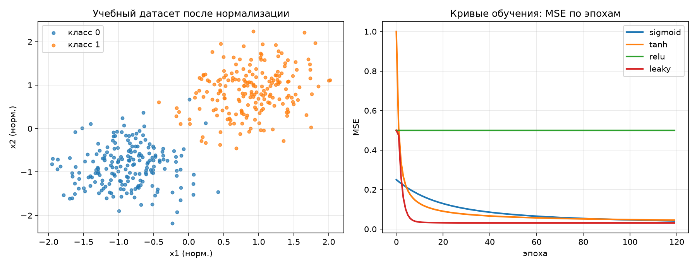
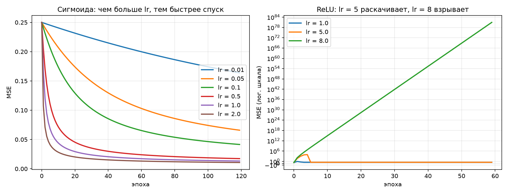
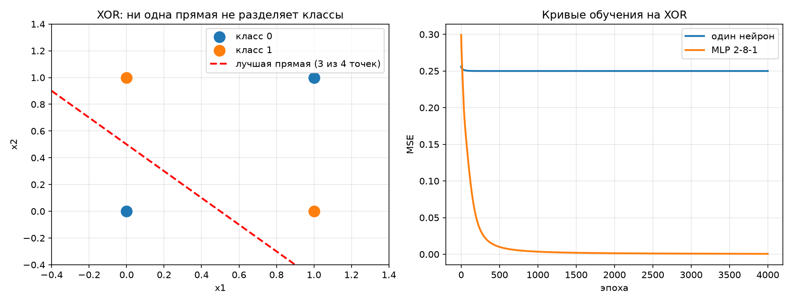

# Лабораторная работа 1.1. Реализация искусственного нейрона и полносвязного слоя на Python с использованием NumPy: прямое распространение, эксперименты с функциями активации, исследование их влияния на обучение

**Дисциплина:** «Нейронные сети в машинном обучении» (Тема 1.1)<br>
**Объём:** 3 академических часа<br>
**Инструменты:** Python 3.9+, NumPy, Matplotlib

## Цель работы

Реализовать с нуля на NumPy искусственный нейрон и полносвязный слой, освоить
прямое распространение сигнала (forward pass), провести серию экспериментов:
влияние функции активации, скорости обучения и инициализации весов на обучение,
повторить исторический эксперимент с XOR и визуализировать всё с помощью Matplotlib.

## План работы

| № | Часть |
|---|-------|
| 0 | Подготовка окружения |
| 1 | Нейрон: прямой проход |
| 2 | Полносвязный слой в матричной форме |
| 3 | Сеть из двух слоёв |
| 4 | Эксперимент А: функция активации и обучение |
| 5 | Эксперимент Б: скорость обучения |
| 6 | Эксперимент В: инициализация весов |
| 7 | Эксперимент Г: задача XOR — повторяем историю 1969 года |

## Что сдать на проверку

1. **Ссылка на репозиторий GitHub** с выполненной работой. Требования к репозиторию:
    - код лабораторной — `lab1_1.py` + `requirements.txt`;
    - графики — в папке `img/`;
    - отчёт — файл `README.md` в корне репозитория;
    - репозиторий публичный, история коммитов отражает ход работы
      (один коммит «всё сразу» в последний день — минус к культуре работы).
2. **Отчёт о лабораторной работе по каждому пункту** — в `README.md`. По каждой из частей 1–7 отчёт содержит:
    - что делали и какой код получился;
    - что наблюдалось при запуске: вывод программы, числа;
    - краткий вывод по части — 2–4 предложения своими словами.
3. **Ответы на вопросы для защиты** (раздел 8) — письменно, тем же `README.md`, в конце файла.

### Шаблон отчёта (`README.md`)

```markdown
# Лабораторная работа 1.1 — Реализация нейрона и полносвязного слоя на NumPy

**ФИО:** ...
**Группа:** ...
**Ссылка на репозиторий:** ...

## Часть 1. Нейрон: прямой проход
- Код: `lab1_1.py`, часть 1
- Результат: `forward` на входе [1.0, 0.5, 2.0] выдал 0.6 (совпало с ручным расчётом)
- Вывод: ...

## Часть 2. Полносвязный слой
- ...
(по такой же схеме — для всех частей 1–7)

## Ответы на вопросы для защиты
1. ...
2. ...
(и т.д. по всем вопросам раздела 8)

## Общий вывод по лабораторной работе
3–5 предложений: что научился делать, что показалось неожиданным, с чем не справился.
```

## 0. Подготовка

```python
import numpy as np
import matplotlib.pyplot as plt

np.random.seed(42)   # фиксируем генератор случайных чисел: у всех одинаковые числа
```

Фиксация генератора (seed) делает «случайные» числа воспроизводимыми: один и тот
же seed всегда даёт одну и ту же последовательность. Без этой строки результаты при каждом запуске были бы другими — сверять и проверять
было бы нечего.

## 1. Часть 1. Нейрон: прямой проход

Нейрон — ровно две операции из лекции 1.1: `z = w·x + b`, затем `y = φ(z)`.

```python
class Neuron:
    def __init__(self, n_inputs, activation="sigmoid"):
        self.w = np.zeros(n_inputs)          # веса
        self.b = 0.0                          # смещение
        self.activation = activation

    def forward(self, x):
        z = np.dot(self.w, x) + self.b       # шаг 1: взвешенная сумма
        return self._activate(z)              # шаг 2: активация

    def _activate(self, z):
        if self.activation == "sigmoid": return 1 / (1 + np.exp(-z))
        if self.activation == "tanh":    return np.tanh(z)
        if self.activation == "relu":    return np.maximum(0, z)
        if self.activation == "linear":  return z
        raise ValueError(f"Неизвестная активация: {self.activation}")

# Проверка на числах из лекции 1.1 (пример с квартирой и нейроном 4.5)
neuron = Neuron(3, activation="linear")
neuron.w = np.array([0.4, -0.6, 0.2])
neuron.b = 0.1
print(neuron.forward(np.array([1.0, 0.5, 2.0])))
```

**Ожидаемый вывод:** `0.6` — совпадает с ручным расчётом лекции.

**Задание 1.1.** Создайте тот же нейрон с `activation="sigmoid"` и `"relu"`,
выведите ответы на тех же входах. В комментарии запишите: почему ответы разные,
а `z` — одно и то же?

## 2. Часть 2. Полносвязный слой в матричной форме

Слой — это «много нейронов сразу»: матрица весов `W` размера `(n_in × n_out)`,
вектор смещений и векторизованный проход для целого батча.

```python
class DenseLayer:
    def __init__(self, n_in, n_out, activation="relu"):
        # Инициализация Ксавье: маленькие случайные веса
        self.W = np.random.randn(n_in, n_out) * np.sqrt(2.0 / (n_in + n_out))
        self.b = np.zeros(n_out)
        self.activation = activation

    def forward(self, X):
        z = X @ self.W + self.b               # X — батч (n_samples, n_in)
        if self.activation == "sigmoid": return 1 / (1 + np.exp(-z))
        if self.activation == "tanh":    return np.tanh(z)
        if self.activation == "relu":    return np.maximum(0, z)
        return z                               # linear

    def n_params(self):
        return self.W.size + self.b.size
```

**Задание 2.1.** Создайте слой 784 → 128 и выведите `n_params()`. Сверьте
с формулой лекции: `784 · 128 + 128 = 100 480`.

**Задание 2.2.** Подайте батч `X = np.random.randn(32, 784)` и убедитесь,
что на выходе матрица `(32, 128)`. Заметьте: ни одного цикла `for` по нейронам —
умножение матриц делает всё сразу. Именно поэтому сети так хорошо ложатся на GPU.

## 3. Часть 3. Сеть из двух слоёв

```python
layer1 = DenseLayer(2, 8, activation="relu")     # скрытый слой
layer2 = DenseLayer(8, 1, activation="sigmoid")  # выходной: вероятность

X_batch = np.random.randn(16, 2)
out = layer2.forward(layer1.forward(X_batch))    # конвейер: (16,2) -> (16,8) -> (16,1)
print(out.shape)
print("Параметров в сети:", layer1.n_params() + layer2.n_params())
```

**Ожидаемый вывод:** `(16, 1)` и `33` (проверьте формулой: `2·8+8 + 8·1+1`).

## 4. Часть 4. Эксперимент А: как функция активации влияет на обучение

Учебный датасет: два «облака» точек, задача — научиться их разделять.
Обучаем **один нейрон** градиентным спуском. Как считаются градиенты — подробно
в теме 1.2; здесь `dz` — это «подсказка, куда двигать веса», её нам даёт математика.

```python
rng = np.random.default_rng(42)
n = 200
X0 = rng.normal(loc=(-1.2, -1.0), scale=0.6, size=(n, 2))   # класс 0
X1 = rng.normal(loc=(1.2, 1.0),  scale=0.6, size=(n, 2))    # класс 1
X = np.vstack([X0, X1])
y = np.array([0]*n + [1]*n, dtype=float)

# Нормализация: среднее 0, разброс 1
X_mean, X_std = X.mean(axis=0), X.std(axis=0)
Xn = (X - X_mean) / X_std

def sigmoid(z): return 1 / (1 + np.exp(-z))

def train_neuron(activation, lr=0.1, epochs=120, init="zeros", init_seed=7):
    r = np.random.default_rng(init_seed)   # свой генератор: результат не зависит
    w = np.zeros(2) if init == "zeros" else r.normal(0, 0.5, 2)  # от порядка ячеек
    b = 0.0
    y_loc = 2*y - 1 if activation == "tanh" else y.copy()
    history = []
    for _ in range(epochs):
        z = Xn @ w + b
        if activation == "sigmoid":
            y_hat = sigmoid(z); dz = (y_hat - y_loc) * y_hat * (1 - y_hat)
        elif activation == "tanh":
            y_hat = np.tanh(z); dz = (y_hat - y_loc) * (1 - y_hat**2)
        elif activation == "relu":
            y_hat = np.maximum(0, z); dz = (y_hat - y_loc) * (z > 0)
        elif activation == "leaky":
            y_hat = np.where(z > 0, z, 0.1*z)
            dz = (y_hat - y_loc) * np.where(z > 0, 1.0, 0.1)
        history.append(np.mean((y_hat - y_loc)**2))
        w -= lr * 2 * Xn.T @ dz / len(y)
        b -= lr * 2 * dz.mean()
    return np.array(history), w, b

hist = {}
for name in ["sigmoid", "tanh", "relu", "leaky"]:
    h, w, b = train_neuron(name)
    hist[name] = h
    z = Xn @ w + b
    pred = (z > 0).astype(float)          # порог классификации
    acc = np.mean(pred == y)
    print(f"{name:8s} loss: {h[0]:.4f} -> {h[-1]:.4f}   accuracy: {acc:.3f}")
```

**Ожидаемый вывод:**

```text
sigmoid  loss: 0.2500 -> 0.0415   accuracy: 0.988
tanh     loss: 1.0000 -> 0.0456   accuracy: 0.995
relu     loss: 0.5000 -> 0.5000   accuracy: 0.500
leaky    loss: 0.5000 -> 0.0313   accuracy: 0.775
```

**Код построения рисунка 1:**

```python
fig, (ax1, ax2) = plt.subplots(1, 2, figsize=(12, 4.6))

ax1.scatter(Xn[y == 0][:, 0], Xn[y == 0][:, 1], s=14, alpha=0.7, label="класс 0")
ax1.scatter(Xn[y == 1][:, 0], Xn[y == 1][:, 1], s=14, alpha=0.7, label="класс 1")
ax1.set_title("Учебный датасет после нормализации")
ax1.set_xlabel("x1 (норм.)")
ax1.set_ylabel("x2 (норм.)")
ax1.legend()
ax1.grid(alpha=0.3)

for name, h in hist.items():
    ax2.plot(h, lw=2, label=name)
ax2.set_title("Кривые обучения: MSE по эпохам")
ax2.set_xlabel("эпоха")
ax2.set_ylabel("MSE")
ax2.set_ylim(-0.02, 1.05)
ax2.legend()
ax2.grid(alpha=0.3)

plt.tight_layout()
plt.savefig("img/lab11_experiment.png", dpi=150)
plt.show()
```



### Разбор результатов

| Активация | loss: начало → конец | accuracy | Что произошло |
|-----------|----------------------|----------|----------------|
| Sigmoid | 0,25 → 0,0415 | 0,988 | Обучилась, ошибка упала в 6 раз |
| Tanh | 1,0 → 0,0456 | 0,995 | Обучилась: центрирование ускоряет спуск |
| ReLU | 0,5 → 0,5 | 0,500 | **Не обучилась вовсе** — см. ниже |
| Leaky ReLU | 0,5 → 0,0313 | 0,775 | Обучилась, но с оговоркой — см. ниже |

**Почему ReLU «умерла».** Стартуем с нулевых весов: `z = 0` для всех точек,
а `ReLU(0) = 0` — нейрон молчит. Производная ReLU при `z ≤ 0` равна нулю,
градиентный шаг ничего не меняет: веса остаются нулями навсегда. Миниатюрная
модель проблемы **умирающих нейронов** из лекции.

**Парадокс leaky: loss низкий, а accuracy всего 0,775.** У leaky нет верхнего
предела: её выходы в эксперименте от −0,046 до 1,487. Ошибка (MSE) мала, но
многие точки сидят близко к границе `z = 0`, и жёсткий порог классификации
ошибается. У sigmoid и tanh выходы «прилипают» к краям диапазона — предсказания
уверенные. **Мораль: малая функция потерь не гарантирует хорошую классификацию** —
к теме метрик качества вернёмся в разделе 7 курса.

**Задание 4.1.** Увеличьте `lr` до 1,0. Что стало с кривыми? Что с ReLU?

## 5. Часть 5. Эксперимент Б: скорость обучения

```python
lrs = [0.01, 0.05, 0.1, 0.5, 1.0, 2.0]
for lr in lrs:
    h, _, _ = train_neuron("sigmoid", lr=lr)
    print(f"lr={lr:5.2f}: loss {h[0]:.4f} -> {h[-1]:.4f}")

# А теперь перебор для ReLU (со случайной инициализацией, init="random")
for lr in [1.0, 5.0, 8.0]:
    h, w, _ = train_neuron("relu", lr=lr, init="random", epochs=60)
    print(f"ReLU lr={lr}: финальный loss = {h[-1]:.2e}, веса = {np.round(w, 2)}")
```

**Ожидаемый вывод:**

```text
lr= 0.01: loss 0.2500 -> 0.1639
lr= 0.05: loss 0.2500 -> 0.0659
lr= 0.10: loss 0.2500 -> 0.0415
lr= 0.50: loss 0.2500 -> 0.0173
lr= 1.00: loss 0.2500 -> 0.0133
lr= 2.00: loss 0.2500 -> 0.0107
ReLU lr=1.0: финальный loss = 5.00e-01, веса = [-0.03  0.04]
ReLU lr=5.0: финальный loss = 5.00e-01, веса = [176.51 146.92]
ReLU lr=8.0: финальный loss = 8.87e+80, веса = [-2.40e+41 -2.52e+41]
```

**Код построения рисунка 2:**

```python
fig, (ax1, ax2) = plt.subplots(1, 2, figsize=(12, 4.6))

for lr in lrs:
    h, _, _ = train_neuron("sigmoid", lr=lr)
    ax1.plot(h, lw=2, label=f"lr = {lr}")
ax1.set_title("Сигмоида: чем больше lr, тем быстрее спуск")
ax1.set_xlabel("эпоха")
ax1.set_ylabel("MSE")
ax1.legend()
ax1.grid(alpha=0.3)

for lr in [1.0, 5.0, 8.0]:
    h, _, _ = train_neuron("relu", lr=lr, init="random", epochs=60)
    ax2.plot(h, lw=2, label=f"lr = {lr}")
ax2.set_yscale("symlog", linthresh=1)
ax2.set_title("ReLU: lr = 5 раскачивает, lr = 8 взрывает")
ax2.set_xlabel("эпоха")
ax2.set_ylabel("MSE (лог. шкала)")
ax2.legend()
ax2.grid(alpha=0.3)

plt.tight_layout()
plt.savefig("img/lab11_lr.png", dpi=150)
plt.show()
```



### Разбор результатов

1. **Для sigmoid всё плавно:** больше `lr` — быстрее спуск, никакого взрыва
   вплоть до `lr = 2`. Причина — затухающие градиенты сигмоиды: они «гасят»
   слишком большие шаги. Это и достоинство (стабильность), и проклятие
   (медленная сходимость в глубоких сетях — об этом тема 1.2).
2. **ReLU при `lr = 5` уже раскачивается:** веса разлетаются до сотен
   (176 и 147), loss скачет от 0,38 до 8500 — система мечется туда-сюда.
   А при `lr = 8` взрыв становится окончательным: ошибка достигает `10^80`,
   веса — `10^41`. Активации ReLU неограничены, поэтому большой шаг безудержно
   раскачивает веса. Догадайтесь, что выведет `print` после ещё 10 эпох
   (спойлер: `nan`).
3. **Правило:** `lr` — самый важный гиперпараметр обучения. Слишком мал —
   учимся вечно; слишком велик — взрыв. Поиск «золотой середины» — задача 2.2.

**Задание 5.1.** Найдите для ReLU экспериментально максимальный `lr`,
при котором обучение ещё не взрывается (с точностью до порядка).

**Задание 5.2.** Объясните письменно: почему sigmoid «прощает» большие `lr`,
а ReLU — нет?

## 6. Часть 6. Эксперимент В: инициализация весов

```python
for init in ["zeros", "random"]:
    h, w, b = train_neuron("relu", init=init)
    print(f"ReLU, init={init:7s}: loss {h[0]:.4f} -> {h[-1]:.4f}, итоговые w = {np.round(w, 3)}")

h, w, b = train_neuron("leaky", init="zeros")
print(f"Leaky, init=zeros      : loss {h[0]:.4f} -> {h[-1]:.4f}, итоговые w = {np.round(w, 3)}")
```

**Ожидаемый вывод:**

```text
ReLU, init=zeros  : loss 0.5000 -> 0.5000, итоговые w = [0. 0.]
ReLU, init=random : loss 0.3801 -> 0.0312, итоговые w = [0.318 0.23 ]
Leaky, init=zeros : loss 0.5000 -> 0.0313, итоговые w = [0.32  0.227]
```

### Разбор результатов

Нулевая инициализация убивает ReLU окончательно: `z = 0` для всех точек — ровно
на изломе функции, градиент нулевой, веса заморожены навсегда. А случайная
инициализация (σ = 0,5) спасает: часть точек сразу попадает в зону `z > 0`,
градиент течёт — и нейрон выходит на решение. Самое интересное: итоговые веса
ReLU почти совпали с весами leaky-нейрона из нулевой инициализации — оба нашли
одну и ту же разделяющую прямую, просто разными путями.

Но покой ReLU хрупок — задание 6.1 покажет, что при неудачном стартовом раскладе
она умирает и со случайной инициализацией.

**Задание 6.1.** Переберите `init_seed` от 1 до 10 в вызове
`train_neuron("relu", init="random", init_seed=k)`. Сколько раз ReLU обучилась,
а сколько — умерла во время обучения? Посмотрите на веса «погибших» запусков:
что у них общего? (Подсказка: посчитайте, у скольких точек датасета `z` положителен
при таких весах. Ориентир для сверки: у автора работы ReLU выжила на 6 из 10 сидов.)

## 7. Часть 7. Эксперимент Г: XOR — повторяем «зиму ИИ»

В лекции 1.1 прозвучало: Минский и Пейперт в 1969-м показали, что однослойный
перцептрон не выучивает XOR. Повторим этот эксперимент своими руками —
четыре точки, а нейросеть бессильна:

```python
Xx = np.array([[0, 0], [0, 1], [1, 0], [1, 1]], dtype=float)
yx = np.array([0, 1, 1, 0], dtype=float)          # XOR: «единица», когда входы разные

# --- Попытка 1: одиночный нейрон ---
def train_xor_single(epochs=4000, lr=0.5, seed=42):
    r = np.random.default_rng(seed)
    w = r.normal(0, 0.5, 2); b = 0.0; hist = []
    for _ in range(epochs):
        z = Xx @ w + b
        p = sigmoid(z)
        dz = (p - yx) * p * (1 - p)
        hist.append(np.mean((p - yx)**2))
        w -= lr * 2 * Xx.T @ dz / 4
        b -= lr * 2 * dz.mean()
    return np.array(hist), w, b

# --- Попытка 2: MLP 2-8-1 ---
# Обратный проход дан готовым: формулы backpropagation разбираем в теме 1.2.
# Здесь важно другое — результат, а механика появится в следующей лабораторной.
def train_xor_mlp(epochs=4000, lr=0.5, hidden=8, seed=42):
    r = np.random.default_rng(seed)
    W1 = r.normal(0, 1, (2, hidden)); b1 = np.zeros(hidden)
    W2 = r.normal(0, 1, hidden);      b2 = 0.0
    hist = []
    for _ in range(epochs):
        a1 = np.tanh(Xx @ W1 + b1)                 # прямой проход
        p2 = sigmoid(a1 @ W2 + b2)
        d2 = (p2 - yx) * p2 * (1 - p2)             # обратный проход (готовый)
        dW2 = a1.T @ d2 / 4; db2 = d2.mean()
        d1 = np.outer(d2, W2) * (1 - a1**2)
        dW1 = Xx.T @ d1 / 4; db1 = d1.mean(axis=0)
        W2 -= lr * dW2; b2 -= lr * db2
        W1 -= lr * dW1; b1 -= lr * db1
        hist.append(np.mean((p2 - yx)**2))
    return np.array(hist), sigmoid(np.tanh(Xx @ W1 + b1) @ W2 + b2)

h1, w1, b1 = train_xor_single()
p_single = sigmoid(Xx @ w1 + b1)
print("Один нейрон, выходы:", np.round(p_single, 3),
      " accuracy:", np.mean((p_single > 0.5).astype(int) == yx))

h2, p_mlp = train_xor_mlp()
print("MLP 2-8-1, выходы:  ", np.round(p_mlp, 3),
      " accuracy:", np.mean((p_mlp > 0.5).astype(int) == yx))
```

**Ожидаемый вывод:**

```text
Один нейрон, выходы: [0.5 0.5 0.5 0.5]  accuracy: 0.5
MLP 2-8-1, выходы:   [0.014 0.976 0.973 0.03]  accuracy: 1.0
```

**Код построения рисунка 3:**

```python
fig, (ax1, ax2) = plt.subplots(1, 2, figsize=(12, 4.6))

ax1.scatter([0, 1], [0, 1], s=140, color="tab:blue", label="класс 0", zorder=3)
ax1.scatter([0, 1], [1, 0], s=140, color="tab:orange", label="класс 1", zorder=3)
xs = np.linspace(-0.4, 1.4, 10)
ax1.plot(xs, 0.5 - xs, "r--", lw=2, label="лучшая прямая (3 из 4 точек)")
ax1.set_xlim(-0.4, 1.4)
ax1.set_ylim(-0.4, 1.4)
ax1.set_title("XOR: ни одна прямая не разделяет классы")
ax1.set_xlabel("x1")
ax1.set_ylabel("x2")
ax1.legend()
ax1.grid(alpha=0.3)

ax2.plot(h1, lw=2, label="один нейрон")
ax2.plot(h2, lw=2, label="MLP 2-8-1")
ax2.set_title("Кривые обучения на XOR")
ax2.set_xlabel("эпоха")
ax2.set_ylabel("MSE")
ax2.legend()
ax2.grid(alpha=0.3)

plt.tight_layout()
plt.savefig("img/lab11_xor.png", dpi=150)
plt.show()
```



### Разбор результатов — самый важный вывод лабораторной

1. **Один нейрон сдался эффектно:** все четыре выхода сошлись к ровно 0,5.
   Он не «почти решил» задачу — он *отказался отвечать*: для XOR никакая прямая
   не разделяет классы, и лучший линейный разделятель даёт максимум 75% точности
   (проверьте это заданием 7.1!).
2. **MLP с одним скрытым слоем из 8 нейронов решил задачу идеально**
   (финальный loss ≈ 0,0006) — и это не везение: скрытый слой умеет «перегибать»
   пространство признаков. Два нейрона строят две границы, их комбинация —
   «уголок», который окружает пару точек одного класса.
3. **Историческая мораль 1969 года подтверждена экспериментально:** проблема
   была не в идее нейросетей, а в их *глубине* и отсутствии метода обучения
   глубоких сетей. Backpropagation 1986 года закрыл вторую проблему —
   им и займётся следующая лабораторная работа.

**Задание 7.1.** Вручную подберите веса одиночного нейрона, дающие accuracy 0,75
(три из четырёх точек верные). Убедитесь: лучше — никак. Проверить можно,
нарисовав прямую на левом графике рисунка 3: она отсекает ровно три точки.

**Задание 7.2.** Уменьшите скрытый слой в `train_xor_mlp` до 2, 3, 4 нейронов
и для каждого размера прогоните 10 сидов (`seed` от 1 до 10). Посчитайте долю
успешных запусков. Ориентир для сверки: при ширине 2 XOR решается на 6 из 10
сидов, при ширине 3 — на 9 из 10, при ширине 4 — на всех 10. Сформулируйте
вывод: как размер слоя влияет на надёжность обучения?

## 8. Вопросы для защиты

1. Почему в `DenseLayer.forward` нет цикла по нейронам? Что его заменяет?
2. Сколько параметров у слоя `DenseLayer(100, 50)`? Посчитайте формулой.
3. Почему ReLU с нулевой инициализацией не обучается, а Leaky ReLU — да?
4. Почему при `lr = 8` ReLU взрывается, а sigmoid — нет?
5. Потеря leaky-нейрона 0,031 при accuracy 0,775 — о чём это говорит
   о связи функции потерь и метрик качества?
6. Почему XOR не решается одним нейроном, но решается сетью с одним
   скрытым слоем? Какие веса вы подобрали в задании 7.1?
7. Зачем нормировать признаки перед обучением? Что изменилось бы без этого?
8. Зачем в коде фиксируется генератор случайных чисел (seed)? Что изменится,
   если убрать эту строку? Почему в `train_neuron` у инициализации свой
   отдельный генератор с параметром `init_seed`?

## 9. Критерии оценки

| Оценка | Критерий |
|--------|----------|
| «удовл.» | Репозиторий оформлен по требованиям, отчёт по шаблону; части 1–4: прямой проход работает, эксперимент А воспроизведён, выводы записаны |
| «хорошо» | Дополнительно: эксперименты Б и В выполнены, рисунки 1–2 построены и вложены в `img/`, задания 5.1–5.2 |
| «отлично» | Дополнительно: эксперимент Г с рисунком 3, задания 7.1–7.2, полные ответы на вопросы защиты |
